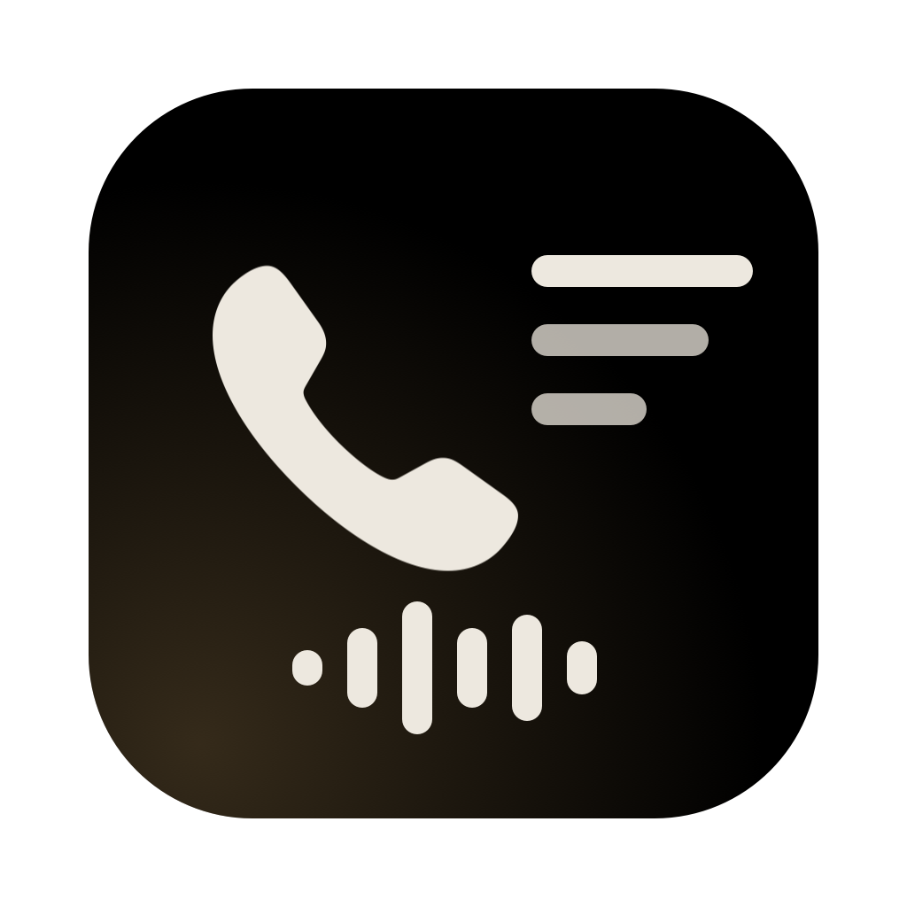

<p align="center"></p>

# CallScribe

Class: personal · Mac · AI: yes · rung 2

**Records your WhatsApp calls on the Mac (after asking), transcribes them locally, and writes the meeting notes you were never going to write.**

[](LICENSE)  [](https://github.com/krosta-codes/call-scribe/releases)

## Why this exists

A lot of my calls happen on WhatsApp, and every time I told myself "I'll write it down after." I did not write it down after. CallScribe sits in the menu bar, notices the call, asks one question, and an hour later I have a note with decisions, to-dos for both sides and the full transcript. Nobody has to join a bot to the call, and the audio never leaves my Mac.

## What it does

- Notices when a WhatsApp call starts (it watches which app uses the microphone, no WhatsApp hacks).
- Pops a small panel: who is it, which project, **Record** or **Not this call**. It never records without that click.
- Records both sides on separate tracks: your mic, and WhatsApp's audio through a macOS process tap. Works with any speakers, headphones or audio interface; if a track stops (device switch, sleeping monitor) it repairs itself during the call, and the note lists any gap. Menu › **Other side audio** pins a device if you ever need to.
- Transcribes on your Mac with whisper.cpp, any language, and labels who said what.
- Writes a Markdown note: summary, decisions, to-dos for you, to-dos for them, open questions, transcript. Works great with Obsidian or any notes folder.
- Remembers which contact belongs to which project, and reads the caller's name from the WhatsApp call window.

## Install

| You need | Why |
|---|---|
| A Mac with Apple Silicon, macOS 14.2 or newer | the audio process tap came with 14.2 |
| [Homebrew](https://brew.sh) | installs ffmpeg and whisper.cpp |
| [Claude Code](https://claude.com/claude-code), logged in | writes the summary; optional, without it you still get the transcript |
| WhatsApp desktop app | the thing being recorded |

1. Clone and run the installer:

   ```
   git clone https://github.com/krosta-codes/call-scribe.git ~/Projects/apps/call-scribe
   ~/Projects/apps/call-scribe/install.sh
   ```

   It checks your Mac, installs Command Line Tools, ffmpeg, whisper.cpp and the speech model (about 1.6 GB), creates the notes folder, builds the app into `~/Applications` and starts it. Every line says `ok`, `warn` or `fail`, and it is safe to run again.

2. On the first call, allow what macOS asks for: Microphone, System Audio Recording, Accessibility (for the caller name), Notifications.

3. Optional, but saves you from re-granting permissions after every update: create a local signing certificate once. Keychain Access › Certificate Assistant › Create a Certificate…, name `<Your name> Local Code Signing`, Identity Type "Self-Signed Root", Certificate Type "Code Signing". Then run `install.sh` again.

4. Menu bar icon › **Start at login**.

## Use it

1. Take a WhatsApp call. The panel appears top right. Check the name and project, say "I'm recording this for my notes, ok?", click **Record**.
2. Hang up. Recording stops on its own after 3 s of silence (or menu › **Stop recording**).
3. Wait for the notification "Call note ready" and click it. Menu › **Open last note** gets you there later.

Where things land:

| What | Where |
|---|---|
| Notes | `~/Documents/CallScribe/Projects/<Project>/calls/<Contact>/<date-time>.md` |
| Audio (kept as m4a) | `~/Documents/CallScribe/Audio/Projects/<Project>/calls/<Contact>/<date-time>/` |
| Log | `~/Library/Logs/CallScribe.log` |

Projects are simply the folders inside `<notes folder>/Projects/`. Create a folder, and it shows up in the panel.

## Updates

CallScribe checks this repo's releases 30 s after start and once a day. A new version shows a notification (once) and the menu item **Update to vX.Y.Z…**, which pulls the new code into your clone, rebuilds and restarts. It refuses while a call is recording or processing. Menu › **Check for updates…** checks right away.

The check is one request to the GitHub API and nothing else. Turn it off: `defaults write com.jurekkrosta.callscribe updateCheck -bool false`

## Configuration

All settings are `defaults` keys in the domain `com.jurekkrosta.callscribe`, for example `defaults write com.jurekkrosta.callscribe myName Alex`.

| Key | Default | What it does |
|---|---|---|
| `vaultPath` | `~/Documents/CallScribe` | notes folder (an Obsidian vault works) |
| `archivePath` | `~/Documents/CallScribe/Audio` | where the audio goes; keep it out of iCloud if space matters |
| `myName` | first name of your macOS account | your name in transcripts and to-dos |
| `nestedProjectFolders` | none | folders inside `Projects/` whose subfolders count as projects, e.g. `-array Clients` |
| `updateCheck` | `true` | daily update check |
| `targetBundlePrefix` | `net.whatsapp` | app to watch; point it at another app at your own risk |

Environment for the processing script: `CALLSCRIBE_CLAUDE_MODEL` (default `sonnet`), `CALLSCRIBE_SKIP_CLAUDE=1` (transcript only), `CALLSCRIBE_SIGN_IDENTITY` (certificate name for `build.sh`).

## How it works

1. Once per second CallScribe asks Core Audio which processes use the microphone. A WhatsApp process with live input means a call.
2. After your click it records `me.caf` (microphone, AVAudioEngine) and `them.caf` (a Core Audio process tap on WhatsApp, written at the output device's real sample rate).
3. On stop, `process_call.sh` converts both tracks to 16 kHz WAV, runs `whisper-cli` per track, merges the lines by timestamp, and drops your mic picking up their voice from the speakers.
4. `claude -p` turns the transcript into the note sections. If that fails, the note is still written with an `ERROR:` line, and the audio is never deleted.

Re-run the pipeline for a recording by hand:

```
~/Projects/apps/call-scribe/process_call.sh "<audio folder of the call>" "<Contact>" "<Project>"
```

Debug commands: `CallScribe --who` (what the panel would pre-fill), `--stop`, `--list` (audio processes), `--check-update`. The binary is `~/Applications/CallScribe.app/Contents/MacOS/CallScribe`.

## Privacy

| What | Where it goes | Turn it off |
|---|---|---|
| Audio, transcript | stays on your Mac | n/a |
| Transcript text, for the summary | Anthropic, through your own Claude Code login | `CALLSCRIBE_SKIP_CLAUDE=1` |
| Update check | one request to api.github.com, no data about you | `updateCheck` = false |

**Consent:** recording a call without the other person's consent is illegal in many places (Germany: section 201 StGB; in the US several states require all-party consent, e.g. California and Florida). That's why the panel shows the sentence to say first. Say it every time.

## Known quirks

- On laptop speakers your mic hears the other side too. The echo filter drops most of those duplicate lines, headphones drop all of them.
- Group calls are called "Group voice call" in WhatsApp, so the name field falls back to whoever you called last.
- whisper can invent a short line during long silences (a lone "Thank you." is its favourite). The transcript keeps it, the summary usually ignores it.
- Rebuilding while a call records restarts the app and ends the recording. The updater knows this, `build.sh` does not.

---

Built by [Jurek Krosta](https://jurekkrosta.com) ("AI Slop - aber richtig").
Licensed under Apache-2.0, see [LICENSE](LICENSE) and [NOTICE](NOTICE).
The name "CallScribe" and the Krosta brand are not covered by the license, see [TRADEMARK.md](TRADEMARK.md).
Need this built for your shop or team? [Contact](https://jurekkrosta.com).
